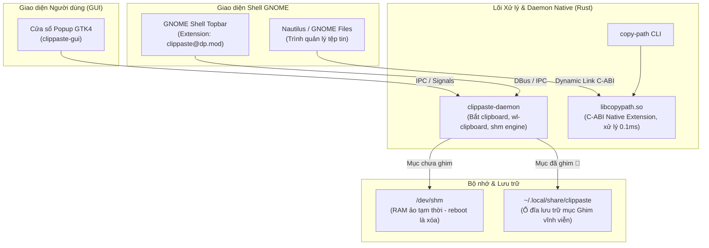

<div align="center">

# 🐧 Ubuntu Custom Mods (Tiếng Việt)

**Bộ công cụ tối ưu hóa hiệu năng, cải tiến công thái học và trải nghiệm làm việc cho Ubuntu / GNOME Desktop.**

[](https://github.com/duyphan0503/ubuntu-custom-mods/actions/workflows/ci.yml)
[](LICENSE)
[](https://ubuntu.com)
[](https://www.rust-lang.org/)
[](https://www.gnome.org/)

[English](README.md) • [Tiếng Việt](README.vi.md)

</div>

---

## 🌟 Tổng quan

**`ubuntu-custom-mods`** là dự án monorepo tổng hợp các tiện ích mở rộng hệ thống native viết bằng **Rust**, **GTK4** và **GNOME Shell extension / C-ABI**. Mục tiêu hàng đầu là đạt tốc độ phản hồi tính bằng micro-giây, chiếm dụng RAM cực thấp (dưới 8MB), thay thế hoàn toàn các ứng dụng cồng kềnh tiêu tốn hàng trăm MB bộ nhớ.

---

## 🏗️ Kiến trúc hệ thống



---

## 📦 Các module trong dự án

### 1. 📋 [ClipPaste](clippaste/) — Quản lý Clipboard Native siêu nhẹ
Quản lý lịch sử sao chép văn bản & hình ảnh chuyên dụng cho Ubuntu:

* **Click là Dán ngay**: Bỏ bước ấn nút thừa, chỉ cần click chuột vào bất kỳ mục nào trong danh sách là cửa sổ tự đóng và dán thẳng vào ô văn bản đang active.
* **Cơ chế lưu trữ RAM thông minh**:
  * *Mục chưa ghim*: Lưu thẳng trong `/dev/shm` (RAM ảo) - tự động xóa sạch khi tắt máy hoặc restart, đảm bảo bảo mật.
  * *Mục đã ghim* (`📌`): Lưu trữ bền vững tại `~/.local/share/clippaste/pinned.json`, không bao giờ mất khi reboot.
* **Vuốt sang trái để xóa (Swipe to Delete)**: Hỗ trợ cử chỉ vuốt touchpad hoặc kéo chuột từ phải sang trái (> 80px) để lộ nút xóa đỏ.
* **Phím tắt `Super + V` & Topbar**: Bật/tắt nhanh bằng phím tắt hoặc icon tinh tế ngay cạnh Workspace indicator ở góc trái thanh Topbar.

### 2. ⚡ [Nautilus Copy Path](nautilus-copy-path/) — Sao chép đường dẫn tệp tức thì
Tích hợp trực tiếp vào menu chuột phải của trình quản lý tệp GNOME Files (Nautilus):

* **Gọi C-ABI trực tiếp (0.1ms)**: Kết nối thư viện Rust native C-ABI (`libcopypath.so`) trực tiếp vào tiến trình Nautilus.
* **Xử lý bất đồng bộ (Zero UI Freeze)**: Tác vụ thông báo DBus và ghi clipboard chạy trên background worker thread tách biệt, đảm bảo Nautilus không bao giờ bị đơ hay giật lag.

---

## ⚡ Bảng so sánh hiệu năng

| Tiêu chí | Ứng dụng Electron thường thấy | Script Python truyền thống | **ubuntu-custom-mods (Rust/Native)** |
| :--- | :---: | :---: | :---: |
| **Mức chiếm RAM (Idle)** | ~150 - 300 MB | ~40 - 70 MB | **< 8 MB** |
| **Độ trễ phản hồi** | ~500ms - 1.5s | ~80 - 150ms | **~0.1ms - 2ms** |
| **Tốc độ vẽ giao diện** | Trung bình | Phụ thuộc khóa GIL | **Mượt mà 60/120 FPS** |
| **Bảo mật lưu trữ** | File SQLite ổ đĩa | File ổ đĩa tạm | **RAM ảo `/dev/shm` + Phân vùng Ghim** |

---

## 🚀 Hướng dẫn cài đặt nhanh

### Cài đặt gói phụ thuộc

```bash
sudo apt update
sudo apt install -y build-essential pkg-config libglib2.0-dev libgtk-4-dev wl-clipboard
```

### Cài đặt ClipPaste

```bash
cd clippaste
chmod +x install.sh
./install.sh
```

### Cài đặt Nautilus Copy Path

```bash
cd nautilus-copy-path
make install
nautilus -q
```

---

## 🛠️ Đóng góp & Phát triển

Dự án tuân thủ các quy tắc mã nguồn mở chuẩn quốc tế:

* [CONTRIBUTING.md](CONTRIBUTING.md) — Quy chuẩn commit [Conventional Commits](https://www.conventionalcommits.org/), quy trình mở Branch & PR.
* [CODE_OF_CONDUCT.md](CODE_OF_CONDUCT.md) — Quy tắc ứng xử cộng đồng.
* [SECURITY.md](SECURITY.md) — Chính sách báo cáo lỗ hổng bảo mật.

---

## 👤 Tác giả & Quản trị

**Duy Phan**
* GitHub: [@duyphan0503](https://github.com/duyphan0503)
* Email: [quyettu347@gmail.com](mailto:quyettu347@gmail.com)

---

## 📄 Giấy phép mã nguồn

Phát hành theo giấy phép mã nguồn mở **[MIT License](LICENSE)**.
